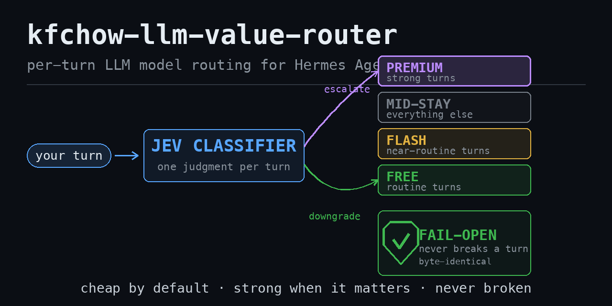

# kfchow-llm-value-router



[](https://doi.org/10.5281/zenodo.23186874)

> **Cite:** KFChow AI Lab (2026). *kfchow-llm-value-router: Jev-driven per-turn model routing for Hermes Agent, resolved from the KFChow AI Lab value leaderboard.* Zenodo. https://doi.org/10.5281/zenodo.23186874

**Powered by the KFChow AI Lab value leaderboard (https://kfchow.com/llm)**

A Hermes plugin that routes each turn to the cheapest model that is *good
enough* for it — and can escalate the hard turns to a premium rung — with a
strict fail-open contract: if anything goes wrong, the request proceeds
byte-identical. Ships in **shadow mode**: it observes and logs decisions until
you deliberately flip it to live.

Developer: KFChow <hotline@kfchow.com> · License: MIT

## What it does

On the **first provider call of each turn** the plugin classifies the turn
once. Later calls reuse the decision, but first re-check the current provider
and source eligibility; removing a lane or allowlisted source takes effect on
the next call, without re-classifying. The plugin:

1. checks eligibility separately for downgrades (`route_providers`) and
   escalation (`escalate_providers`); an already-free source and a no-op
   rewrite are skipped;
2. asks the TypeSafe "Jev" classifier which pool the turn belongs to and its
   confidence (bounded timeout);
3. in `shadow` mode records the decision without rewriting; in `live` mode
   rewrites the request model to the eligible same-provider rung;
4. credit-probes a paid escalation on a metered lane and fails closed if the
   account cannot be verified.

### The four-tier ladder (v1.0.10 banding + D7)

The following uses the **example** gates `flash_gate=0.35`,
`confidence_gate=0.65`, and `escalate_confidence_gate=0.80`. The last gate
also sets the free-pool mid/free boundary.

| Classifier verdict | Confidence | Target |
|---|---:|---|
| paid pool | ≥ 0.80 | premium (if escalation-eligible; metered lanes credit-probed) |
| paid pool | < 0.80 | source model, by default |
| free pool | ≥ 0.80 | free |
| free pool | 0.65–<0.80 | mid |
| free pool | 0.35–<0.65 | flash |
| free pool | < 0.35 | free (routine band) |

**D7 default:** absent or `false`, `paid_pool_routine_band` leaves paid-pool
verdicts below `flash_gate` on their source model. Set
`"paid_pool_routine_band": true` in `lane2_config.json` to restore the
v1.0.10 pool-agnostic routine band (paid and free verdicts below 0.35 ride
free). All downgrade bands require routing-lane eligibility. A missing rung
leaves the request on its source. Flash, mid and free never perform the credit
probe. `confidence_gate` falls back to 0.80 in code if no JSON or panel value
is present; the example and manifest panel default are 0.65.

### Source and provider eligibility

`source_mode` narrows the source model on **each** provider lane:

| `source_mode` | Eligible source models |
|---|---|
| `"any"` (default; also unset / null / empty) | any source on the corresponding listed provider; model lists are ignored |
| `"allowlist"` | downgrades require `route_providers` **and** `route_models`; escalation requires `escalate_providers` **and** `escalate_models` |
| `["model-a", "model-b"]` | only those exact sources, on the corresponding listed providers |

A provider listed only in `escalate_providers` can escalate but cannot use a
downgrade band. An unrecognised `source_mode` falls back to `"allowlist"`
with a warning. A source already on a free model (`:free`, `free`,
`space-bunny`) and a target identical to the source are never rewritten.

## Per-request kill switch (`X-KFC-Router`, v1.0.8)

A client can turn routing OFF for **its own request** — no config edit, no
restart, zero effect on any other turn. Clients that don't send the flag get
normal routing (the blast radius of the feature is one request). Two
interchangeable forms ride on the provider payload:

| Form | Example |
|---|---|
| HTTP header | `X-KFC-Router: off` |
| JSON body | `"metadata": {"router": "off"}` (or the top-level `"router": "off"`) |

Disabling values: `off`, `0`, `false`, `disable`, `disabled` (case-insensitive,
as is the header name). When the flag is set the router stands down completely:
no rewrite, **no classifier call** (no Jev spend on a turn you won't route), no
credit probe, one log row with `skip_reason: "disabled_by_request"` and
`applied: false`, and **no decision stored** — so a later callback of the turn
finds nothing to re-apply. An unknown value (`X-KFC-Router: banana`) is ignored
with no warning; the flag only ever turns routing OFF — the plugin-level switch
stays the `enabled` config key.

Because the middleware layer re-reads the flag from the payload on **every**
callback, a flag that appears on a later call of a turn also stops the
re-application of an earlier decision — the rewrite cannot reappear mid-turn.

## Safety & privacy (full details in [docs/SAFETY.md](docs/SAFETY.md))

- **Fail-open**: any error/timeout/malformed answer returns `None`; the
  original request is untouched. The plugin can fail to route; it never fails
  a turn. With no flash rung configured the flash band stays on the source
  model — an absent tier can never break a turn.
- **Shadow by default**. Since v1.0.9 the Desktop plugin-settings panel's
  saved `enabled`, `mode` and `confidence_gate` values override the JSON on
  every call; the panel can switch to live without a JSON edit or restart.
- **Credit probe fails closed**: escalation to a paid premium rung only fires
  when the metered lane answers a live probe; unknown state = no escalation.
  The flash tier never probes and never needs a key.
- **A rewrite never crosses providers**: rungs resolve per provider.
- **Local-only telemetry**: decision logs go to `~/.hermes/jev/lane2-live.jsonl`
  (0600), nothing is uploaded.
- **`send_excerpt` toggle**: the classifier is sent turn shape features
  (counts, flags) plus, by default, a capped 1200-char excerpt of the last
  user message — this is load-bearing (shape-only scoring mislabels hard
  questions, measured 0.31 vs 1.00 accuracy). Set `"send_excerpt": false` in
  the config to keep task text out of BOTH the vendor call and the log;
  expect reduced routing accuracy.
- **Optional keys, never forced**: `JEVI_API_KEY` (vendor classifier) and
  `NOUS_API_KEY` (credit probe) are optional environment variables. Without
  them the plugin degrades safely — without the Jev key it routes nothing
  (fail-open); without the Nous key it simply never escalates on metered
  providers. Keys come from the process environment; the vendored client has
  one fallback — a plain `~/.hermes/secrets/jev.creds` file **you own** (line
  1 = key, 0600) — used only when `JEVI_API_KEY` is unset. Nothing is ever
  read from `.env` files.

## Install (plugin)

**Option A — from the plugin catalog** (once listed):

```bash
hermes plugins install kfchow-llm-value-router
```

**Option B — manual, from this repo:**

```bash
git clone https://github.com/kfchow-ai/kfchow-llm-value-router.git
hermes plugins install ./kfchow-llm-value-router
```

Then set the optional keys (either is enough to start; both enable full
behaviour) and copy the example config:

```bash
export JEVI_API_KEY=...    # vendor classifier — omit to run resolver-only
export NOUS_API_KEY=...    # credit probe — omit to disable escalation on metered providers
mkdir -p ~/.hermes/jev
cp examples/lane2_config.example.json ~/.hermes/jev/lane2_config.json
```

Config lives at `~/.hermes/jev/lane2_config.json` (honours `HERMES_HOME`).
Resolve your rungs before flipping anything to live:

```bash
python3 scripts/llm-rank-resolver.py        # writes ~/.hermes/jev/llm_rungs.json
python3 scripts/llm-rank-resolver.py --dry-run   # print only
```

In legacy mode the resolver reports leaderboard names; map them to IDs in
`rungs.<provider>` yourself. The middleware does **not** consume the legacy
resolver output automatically. Shadow is the default, but a previously saved
Desktop panel value for `enabled`, `mode` or `confidence_gate` wins over the
JSON; check the panel before assuming routing is still shadowed.

## Install (skill — the method, without the plugin)

The repo also ships the leaderboard-to-rungs method as a standalone Hermes
skill, so you can use the resolver without the routing middleware:

```bash
# via a skills tap
hermes skills tap add kfchow-ai/kfchow-llm-value-router
hermes skills install kfchow-ai/kfchow-llm-value-router/skills/llm-value-leaderboard-rungs

# or single-repo install
hermes skills install kfchow-ai/kfchow-llm-value-router/skills/llm-value-leaderboard-rungs
```

## The KFChow value rule (legacy default)

premium = the highest AAII score among the **top-5 by value** on
https://kfchow.com/llm; mid = the same rule under a **$1.00/Mtok** price
ceiling. The legacy resolver reads the RSS feed and keeps the last good file
on a failed parse. This rule and its output are unchanged unless the new mode
is explicitly selected.

## Opt-in AAII-band resolver (Nous only)

To use the new resolver, put `"ladder_mode": "aaii_bands"` in
`lane2_config.json` and fill **all four existing** `rungs.nous` pins first.
Those are the retention baseline if the board has no qualifying candidate;
the resolver will not create an incomplete ladder. Optionally set
`rungs_path` to the intended output path; otherwise it defaults to
`$HERMES_HOME/jev/llm_rungs.json` (or `~/.hermes/jev/llm_rungs.json`).
Keep `route_providers` and `escalate_providers` explicitly scoped to the
providers you intend to use. The AAII document itself is Nous-only.

```bash
# Requires NOUS_API_KEY for the Nous catalog and exact-model probes.
python3 scripts/llm-rank-resolver.py --dry-run  # probes candidates; no write
python3 scripts/llm-rank-resolver.py            # atomically writes rungs_path
```

`--config PATH` selects a different lane2 JSON; `--ladder-mode aaii_bands`
overrides the resolver mode for that invocation, but **does not edit the
middleware config**. `--board-url`, `--nous-base-url`, and `--out` override
individual endpoints/output. `KFCHOW_BOARD_URL`, `NOUS_BASE_URL`, and
`KFCHOW_RUNGS_OUT` are the corresponding environment overrides. If `--out` or
`KFCHOW_RUNGS_OUT` differs from `rungs_path`, point the middleware at the same
file explicitly. The Desktop panel does not wire `ladder_mode` or
`paid_pool_routine_band`; set these in the JSON.

The resolver reads the full `models.json` board, including **unranked** rows,
and uses only `intelligence_score` (AAII) and `pricing.blended` (Avg); it never
uses `blended_lowest` as a price substitute. Rows without Avg or with missing
or sub-25 AAII are excluded. Bands are premium AAII > 50, mid 40–50, flash 25–<40, and free
zero-price or `:free` IDs with AAII ≥ 25. An ID, or its `:free` variant, must
be in the Nous `/v1/models` catalog and pass a one-token probe. Among the
probe-green candidates, find the lowest Avg and choose the highest AAII among
those within 10% of that price; ties break by lower Avg then model ID. Probes
may incur charges, **including in dry-run**.

Each tier contains `model`, `price_avg`, `aaii`, `status`, `collapsed_into`,
`reason`, and persisted `fold_streak`; the document also records
`rewrite_allowed`, candidate details, alerts, shadow checks, and up to seven
days of board-price history. `price_reference_model` identifies the board row
used for Avg if the catalog supplies only its `:free` variant. That Avg is a
board reference, not a claim about the variant's actual charge. If a retained
`:free` pin has no matching board price, its `price_avg` stays null; it is
retained and an unknown/below-floor AAII is flagged.

A lower tier whose candidate Avg exceeds the stronger active tier's Avg fails
the operative **1.0×** dominance rule. Two consecutive failures collapse it
into the tier above; two consecutive passes reactivate it. While the first
failure is pending, an unsafe retained pin is not a rewrite target. A collapsed
mid remains a dormant slot: its confidence band uses the next cheaper active
slot (flash/free) or stays on source, **never premium**. A refresh that
changes a cached target stops replaying the old target until the next turn.
The stricter mid 0.5× and flash 0.25× ratios and price moves (>50% against the
seven-day median, or >2× within a day) are **shadow alerts only**; they never
trigger folding. A candidate-less tier retains its prior pin and raises an
alert. A board fetch, schema or catalog error exits non-zero without replacing
the last good file. If no valid AAII file exists, middleware leaves requests
unchanged rather than guessing. The [full synthetic rung document](tests/fixtures/aaii_today_expected_rungs.json)
shows the today-board fixture's two-refresh collapse; it is not a live
availability claim.

## FAQ — the traps we hit so you don't have to

**The feed parses but returns zero rows.**
The ranking lives in each RSS ITEM's `<description>`, not the channel-level
description (that's prose). Scope your parser to `<item>` first, then read
the description inside it.

**Paid models suddenly fail with HTTP 404.**
On at least one metered provider, credit exhaustion is a **404** ("requires
available credits"), not a 402. Don't build escalation logic that assumes an
empty balance looks like a payment-required error — probe the paid lane and
fail closed before escalating.

**A strong "thinking" model returns `content: null`.**
Reasoning-heavy models on some providers return the answer in a
`reasoning_content` field with `content: null`, and the endpoint requires a
session header (`x-opencode-session`) plus a real user agent. Read both
fields and send the headers before declaring the response empty.

**My free model id stopped working with no warning.**
Free-period ids expire silently. Never hardcode them — resolve from the
leaderboard feed on a cadence (it updates twice daily).

**Can I route between different providers in one rewrite?**
No — never. The request's `base_url`/`api_key` belong to the ORIGINATING
provider; swapping only the model id sends the wrong id to the wrong
endpoint. Rungs are resolved per provider and rewrites stay same-provider.

## Files

```
├── plugin.yaml                # manifest (provides_middleware: [llm_request, llm_execution])
├── __init__.py                # the middleware (request: classify+rewrite; execution: re-apply)
├── scripts/jev_client.py      # vendored vendor client (env-first key)
├── scripts/llm-rank-resolver.py  # legacy RSS / opt-in AAII resolver entrypoint
├── scripts/aaii_bands.py       # catalog, probes, fold state and shadow checks
├── skills/llm-value-leaderboard-rungs/   # the method as a standalone skill
├── examples/lane2_config.example.json   # config template (shadow)
├── docs/SAFETY.md             # fail-open / fail-closed / disclosure contract
└── tests/                     # offline test suite (no network, no keys)
```

## Development

```bash
PYTEST_DISABLE_PLUGIN_AUTOLOAD=1 python3 -m pytest -q
```

All tests are offline: classifier, catalog, probes and board use synthetic
fixtures/test doubles; real credentials are unset, per-test caches and state
are isolated, and DNS/socket operations are blocked. The suite does not touch
a real network or key.

## License

MIT — see [LICENSE](LICENSE).
